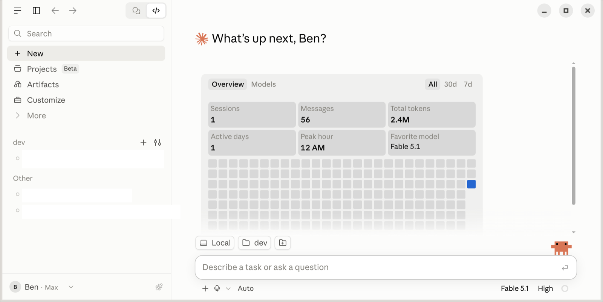

# Claude Black

A completely isolated second instance of **Claude Desktop** on one Mac. The Linux
beta of Claude Desktop runs in a Docker container under [OrbStack](https://orbstack.dev)
and is displayed on macOS through [xpra](https://xpra.org), launched by a
re-badged `/Applications/Claude Black.app`. It runs with its own home, keyring,
and MCP configuration, fully isolated from anything else on the machine, and gives
you the graphical Desktop frontend in that sandbox rather than only the CLI.

<br clear="left">



<sub>Screenshot with conversation titles redacted.</sub>

## Why

Claude Desktop's built-in SSH remote sessions reuse the native app's signed-in
account, so they can't provide a second, independent account. Running the Linux
build in a container and viewing it over xpra does.

## Quick start

```sh
./up.sh            # build the image and start the container
./build-app.sh     # build and install /Applications/Claude Black.app
open -a "Claude Black"
```

After that, launching the app alone starts OrbStack and the container if needed.
Everything for the instance lives in `~/VM_Workspace` (the container's home,
bind-mounted), so sign-in, keyring, `~/.claude`, and projects persist on the Mac.

## Layout

| Path | Purpose |
|------|---------|
| `Dockerfile`, `compose.yaml`, `up.sh` | The container: Claude Desktop + xpra server + dev tools. |
| `build-app.sh` | Assemble, patch, sign, and install the macOS app. |
| `assets/`, `tools/make-logo.py` | The app logo and its pure-stdlib generator. |
| `docs/` | Full documentation (below). |

- [docs/README.md](docs/README.md) — overview and architecture
- [docs/container.md](docs/container.md) — the Docker image and its patches
- [docs/macos-app.md](docs/macos-app.md) — building, signing, installing the app
- [docs/orbstack.md](docs/orbstack.md) — OrbStack-specific notes
- [docs/xpra-findings.md](docs/xpra-findings.md) — HiDPI, the resize limitation, references
- [docs/troubleshooting.md](docs/troubleshooting.md) — known issues and fixes

## Known limitations

Window resize (edge-drag and tiling hotkeys) does not work; fullscreen is the only
sizing control. This is a GTK-on-Quartz / frameless-Electron limitation,
independent of display scaling. See [docs/xpra-findings.md](docs/xpra-findings.md).
